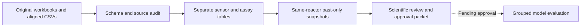

# BioSynvia

**Reproducible data engineering and scientific evidence for CHO bioprocess soft sensing.**

BioSynvia is building toward current viable cell density (VCD) estimation, future
forecasting and exploratory optimization, with a digital twin as the longer-term
goal. The current release is an engineering checkpoint: **no predictive model has
been fitted and no digital twin has been validated**.

## What works today

| Capability | Evidence |
| --- | --- |
| Excel/CSV source inspection and EDA | Twelve experiments, paired reactors, exact source schemas and reproducible scripts |
| Source preservation and provenance | Checksums, separate backups, original blank/zero distinctions and source-cell lineage |
| Controlled feature snapshots | Same-reactor, past-only selection with quality and availability flags |
| Leakage safeguards | Experiment grouping, forbidden offline predictors and adversarial tests |
| Scientific decision support | Published-method review, six uncertain zero-VCD cases and explicit sample-count tradeoffs |



## Try a dataset-free demo

Python 3.11+; the core audit has no third-party dependencies or credentials.

```sh
python3 -m biosynvia audit \
  --sensors examples/synthetic/sensors.csv \
  --measurements examples/synthetic/measurements.csv \
  --output outputs/synthetic-audit.json

python3 -m unittest tests.test_audit tests.test_source -v
```

The example values are invented software fixtures, not biological results.
The audit writes a JSON report and preserves the deliberately blank assay value.
Use a new output filename when rerunning; existing results are protected.
The public core tests run without the research dataset. Full analysis and
released-bundle tests have additional dependency/data requirements.

## Review the work

- [Recruiter walkthrough](docs/recruiter-walkthrough.md): a two-minute reading order and presentation guide.
- [Scientific approval packet](reports/scientific-closure/approval-packet.md): confirmed facts, inferences, author questions and nine pending owner decisions.
- [Official implementation report](reports/implementation-report.md): completed work, corrections and verification.
- [EDA findings](reports/eda-v2/report.md) and [preparation workflow](docs/data-preparation-workflow.md).
- [Scripts and reproduction](scripts/README.md), [requirements](docs/specifications/README.md) and [public repository scope](docs/publication-scope.md).

## Research status

The scientific review found important distinctions: publisher alignment can use
future neighbors, held process values are not fresh acquisitions, and five of six
uncertain VCD zeros occur in a contaminated reactor. The proposed conservative
research cohort has 308 supported positive records; alternative policies and
split choices remain unapproved. These are feasibility counts, not accuracy results.

Original data, backups and processed research bundles stay local. Reports may link
to generated artifacts excluded from this public repository. The source dataset is
[Uhlendorff et al., Zenodo record 20829178](https://zenodo.org/records/20829178);
methods are in the [author preprint](https://www.preprints.org/manuscript/202611.0377).
Dataset reuse terms remain unresolved. See the publication-scope note for details.

## Research paper and dataset citations

**Data descriptor:** Uhlendorff, S., Fulek, R., Eimler, J., Pein-Hackelbusch, M.,
& Frahm, B. (2026). *Data Descriptor: Multimodal Dataset of Bioreactor Cell
Cultivations Including Turbidity, Permittivity, O₂ and CO₂ Measurements* (Version 1)
[Preprint]. Preprints.org. [doi:10.20944/preprints202611.0377.v1](https://doi.org/10.20944/preprints202611.0377.v1).
Version 1 is not peer reviewed.

**Dataset:** Uhlendorff, S., Fulek, R., Eimler, J., Pein-Hackelbusch, M., & Frahm, B.
(2026). *Dataset Based on Chinese Hamster Ovary (CHO) Cultivations including
Turbidity, Permittivity, O2 and CO2 Measurements* (Version v1) [Data set]. Zenodo.
[doi:10.5281/zenodo.20829178](https://doi.org/10.5281/zenodo.20829178).

See [full citations and attribution](CITATIONS.md) and [BibTeX](references.bib).
The original authors produced the study/data; BioSynvia provides the independent
software and analyses. The preprint's CC BY license does not establish a license
for the separate dataset.

## Next milestones

1. Approve the research cohort, feature/timing policy and experiment split.
2. Compare baselines, regularized models and a bounded nonlinear model with grouped evaluation.
3. Add forecasting, uncertainty and prospective real-time validation.
4. Explore optimization and hybrid/digital-twin components when evidence supports them.

AI tools assisted implementation and review. Tests and primary scientific sources
provide the evidence. Model fitting remains paused pending owner approval.
