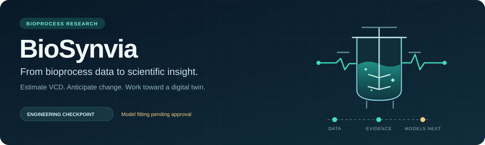
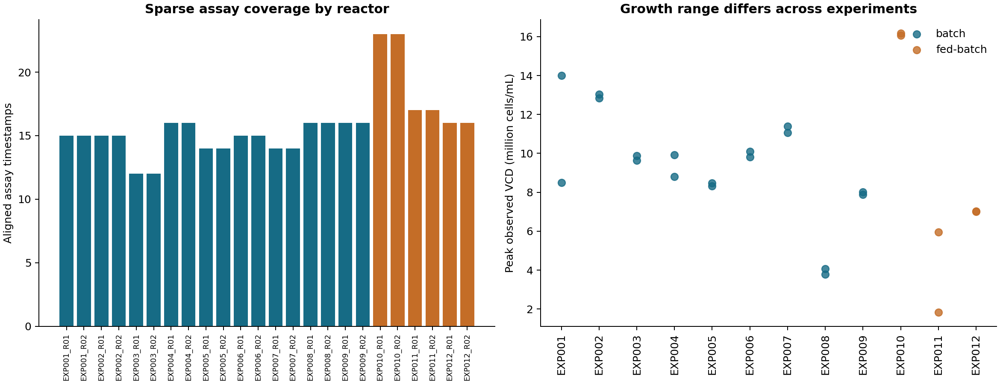
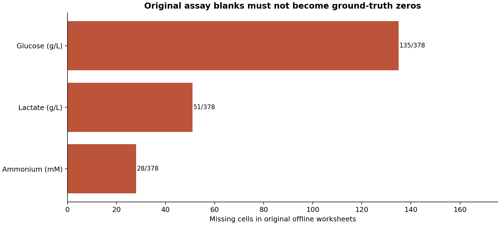
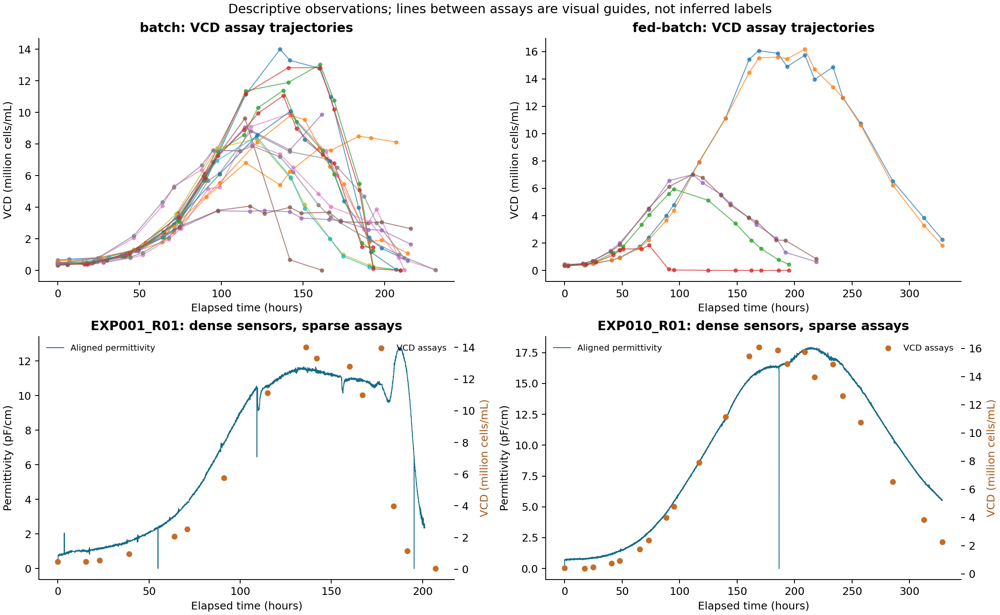
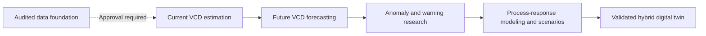

<div align="center">



<br/>

[](pyproject.toml)
[](#%EF%B8%8F-tech-stack)
[](#%EF%B8%8F-tech-stack)
[](#%EF%B8%8F-tech-stack)
[](pyproject.toml)
[](#%EF%B8%8F-research-roadmap)
[](tests/test_audit.py)
[](LICENSE)

<br/>

> **Researching whether reliable monitoring and digital simulation can reduce unnecessary
> manual sampling, reveal abnormal culture behaviour earlier, and guide physical
> experiments - toward a validated hybrid digital twin for CHO bioprocesses.**

<br/>

<sub><b>Stages 1–2</b> — data auditing, exploratory analysis and scientific-evidence review.<br/>Engineering checkpoint accepted. Model fitting remains paused pending approval.</sub>

<br/>

[📊 Overview](#-overview) &nbsp;·&nbsp;
[🧬 Dataset](#-dataset-at-a-glance) &nbsp;·&nbsp;
[🛠️ Tech Stack](#%EF%B8%8F-tech-stack) &nbsp;·&nbsp;
[⚖️ Feature Policy](#%EF%B8%8F-feature-and-timing-policy) &nbsp;·&nbsp;
[🔑 Findings](#-key-findings) &nbsp;·&nbsp;
[📸 Visuals](#-visual-outputs) &nbsp;·&nbsp;
[🗺️ Roadmap](#%EF%B8%8F-research-roadmap) &nbsp;·&nbsp;
[🚀 Setup](#-setup) &nbsp;·&nbsp;
[📚 Citations](#-research-citations)

</div>

---

## 📊 Overview

Cell-culture experiments demand careful monitoring, and contamination can compromise
an entire cultivation. Reference assays are essential, but frequent manual sampling
and intervention add effort and can create opportunities for contamination. Sensor
data and digital models offer a route worth investigating: understanding more about
a culture while disturbing it less.

**BioSynvia's goal is to explore lower-intervention bioprocess research through
reliable state estimation, forecasting and virtual experimentation.** The research
question is whether these capabilities can help reduce avoidable sampling, recognize
abnormal behaviour earlier and prioritize physical experiments during development.

The first building block is a **VCD soft sensor**: estimating viable cell density
from inline measurements. VCD describes living-cell concentration; a fuller picture
of cell health also needs viability, metabolic and process context. Forecasting and
anomaly research follow, before process-response modeling and digital scenarios.

<br/>

| Research step | Intended contribution | Current position |
|:--------------|:----------------------|:-----------------|
| 📊 **Trustworthy data foundation** | Establish what was measured, when and in which reactor | Source audits, EDA and lineage implemented |
| 🤖 **Current VCD estimation** | Investigate more frequent culture-state estimates between reference assays | First modeling objective; no models fitted |
| 📈 **Future VCD forecasting** | Anticipate growth changes or decline | Separate future evaluation |
| 🔬 **Abnormal-culture warning research** | Investigate unusual signals, uncertainty and abstention | A documented contaminated run is retained as a challenge case |
| 🎯 **Process-response modeling** | Explore how cultures respond to feed, oxygen, temperature and other changes | Requires causal/mechanistic evidence and targeted validation |
| 🧬 **Validated hybrid digital twin** | Combine observations and dynamics to test bounded scenarios digitally before selected physical experiments | Long-term research goal |

**Potential benefits remain hypotheses to test.** This project has not demonstrated
reduced contamination, reduced sampling, fewer physical experiments or operational
control. Physical reference experiments, aseptic technique and prospective
validation remain essential. A digital twin does not itself prevent contamination.

The motivation is consistent with [manufacturer work on inline CHO monitoring](https://www.hamiltoncompany.com/knowledge-base/application-note/online-monitoring-of-cho-cell-culture)
and [NIST's emphasis on digital-twin testing and validation](https://www.nist.gov/programs-projects/digital-twins-advanced-manufacturing).
These provide context for the research path, not validation of BioSynvia.

---

## 🧬 Dataset at a Glance

| | |
|:---|:---|
| 📁 **Source** | Uhlendorff et al. (2026), [Zenodo CHO cultivation dataset](https://doi.org/10.5281/zenodo.20829178) |
| 🧪 **Experimental units** | **12 experiments**, each with R01/R02: **24 CHO-K1 cultivations** |
| ⚙️ **Modes** | 9 batch experiments and 3 fed-batch experiments |
| 📚 **Raw structure** | 12 workbooks × 16 reactor-specific worksheets |
| 🔗 **Aligned exports** | 24 inline CSVs × 41 columns; 24 offline CSVs × 17 columns |
| 📐 **Reported variables** | 38 continuous inline and 10 primary offline variables, plus timestamps, SEMs and cumulative logs |
| 🎯 **Reference records** | **378 offline assay records**—not 378 independent experiments |
| 🧫 **Named media** | TC-42 and TCX6D, with reported condition variations |

<details>
<summary>🔍 &nbsp;<b>What the measurements contain</b></summary>

<br/>

**Inline/process:** permittivity, turbidity, dissolved CO₂, pH, dissolved oxygen,
temperature and operating variables.

**Offline:** VCD, total cell density, viability, cell properties, glucose, lactate,
ammonium and osmolality. No measured amino-acid profiles are supplied.

Original Excel cells retain assay values, blanks, source timestamps and supplied
quality fields. Publisher-aligned CSVs are useful for descriptive exploration but
are not automatically causal feature tables. The source archive, processed
observation bundles and full reference documents remain local.

Methods: [data-descriptor preprint](https://doi.org/10.20944/preprints202611.0377.v1),
version 1, not peer reviewed. [Full attribution](CITATIONS.md).

</details>

---

## 🛠️ Tech Stack

These technologies are used in the implemented foundation; planned modeling is
listed separately from completed work.

| Layer | Technology | Role in BioSynvia |
|:------|:-----------|:------------------|
| 🐍 **Language / CLI** | Python 3.11+, `argparse` | Local audits, preparation and reproducible command-line workflows |
| 🧹 **Data processing** | pandas, NumPy | Copied working tables, profiling, numeric checks and feature preparation |
| 📗 **Excel ingestion** | openpyxl | Read workbook streams, original cells, headers and coordinates |
| 🗃️ **Storage / queries** | SQLite (`sqlite3`), CSV, JSON | Persistent analysis tables, source lineage and decision artifacts |
| 📈 **Visualization** | Matplotlib | Descriptive EDA, coverage and relationship figures |
| 🔐 **Provenance** | `hashlib`, `zipfile`, `pathlib` | Checksums, archive inspection and source/output preservation |
| 🧪 **Verification** | Python `unittest` | Identity, timing, missingness, reproducibility and failure-path checks |
| 📄 **Document generation** | ReportLab, pypdf | Generate and preserve versioned project specification documents |
| 🗂️ **Version control** | Git, GitHub; Mermaid/SVG documentation | Code history, evidence navigation and workflow presentation |

**Planned after approval:** baseline, Ridge, PLS and bounded nonlinear comparisons,
followed by uncertainty evaluation and a separate forecasting protocol. These are
not completed model results or installed product capabilities.

The core synthetic audit uses the Python standard library only. Analysis workflows
have separate dependencies recorded in [the scripts guide](scripts/README.md).

---

## ⚖️ Feature and Timing Policy

A useful estimate must respect **which reactor produced the observation and when
the information would have been available**.

| Information | Proposed treatment | Reason |
|:------------|:-------------------|:-------|
| Same-reactor sampled sensors | Past-only candidates with freshness and quality checks | Prevent future or cross-reactor information from entering a snapshot |
| pH, oxygen and temperature process states | Distinguish held state from fresh acquisition; absent Status stays unknown | Change-only logging can forward-fill values |
| Publisher-aligned signals | Descriptive use; causal reconstruction required before modeling | Nearest-neighbor alignment can select a future observation |
| Assay-updated feed history | Withhold until point-in-time availability is established | Control updates used offline VCD/glucose information |
| Offline assays and SEMs | Targets/diagnostics, not sensor-only predictors | Avoid target-derived inputs and unknown result latency |
| Experiment/reactor IDs | Grouping and provenance, not predictive shortcuts | Paired reactors stay inside their whole experiment group |

<details>
<summary>⏱️ &nbsp;<b>Retrospective support is not real-time validation</b></summary>

<br/>

Existing support counts assume sensor acquisition equals availability for a
retrospective research scenario. Strictly requiring evidenced result availability
currently yields **zero supported rows**. This is a timing-evidence gap, not a
claim that all sensor measurements are invalid.

Similarly, requiring an explicit `Ok` on every eight-core input yields zero
complete rows because some streams have no Status field. An absent field,
blank status, warning and invalid measurement remain different states.

</details>

---

## 🔑 Key Findings

<details>
<summary>🦠 &nbsp;<b>Contamination is a research challenge, not a validated detection claim</b></summary>

<br/>

The authors document contamination in **EXP011 R02**, alongside antibiotic exposure
of both reactors and later termination of R02 feed/oxygen enrichment. The proposed
primary cohort keeps EXP011 separate, retaining it for challenge and sensitivity
analyses rather than silently discarding it.

After modeling approval, the question is whether models trained on other
experiments flag unusual behaviour, express increased uncertainty or abstain.
Such a warning would not diagnose contamination or identify its cause. The six
uncertain zero-VCD records remain a separate label-interpretation problem.

**One contaminated cultivation is a case study.** It cannot establish detector
sensitivity, specificity, dependable early-warning lead time or generalization.
Additional labeled events, uncontaminated controls and prospective testing would
be needed before making a contamination-warning claim.

</details>

<details>
<summary>🧪 &nbsp;<b>Six recorded zeros need separate scientific interpretation</b></summary>

<br/>

All six VCD zeros are numeric source values. Five occur in contaminated EXP011 R02;
the EXP002 R02 case is separately unresolved. Contamination supplies context, not
proof of the exact meaning or QC disposition of each zero. Every case is retained
for explicit challenge/sensitivity analysis rather than silently accepted or erased.

</details>

<details>
<summary>🧹 &nbsp;<b>214 original blanks cannot become measured zeros</b></summary>

<br/>

There are **135 glucose**, **51 lactate** and **28 ammonium** blanks. The paper
describes below-detection/quantification concentration results; numerical bounds
are not supplied. Preserve that encoding and uncertainty rather than substituting
measured zeros or assuming random missingness.

</details>

<details>
<summary>📐 &nbsp;<b>A cohort decision changes the research question and sample count</b></summary>

<br/>

At the stated five-minute retrospective policy, separating uncertain zero labels
and choosing a contamination policy produces:

| Proposed cohort | Positive source records | Supported positive records |
|:----------------|------------------------:|---------------------------:|
| Retain all EXP011 | 372 | 333 |
| Quarantine EXP011 R02 | 360 | 322 |
| Quarantine all EXP011 | 343 | **308** |

These are **feasibility counts, not accuracy results**. The conservative proposal
quarantines all EXP011 because contamination and both-reactor antibiotic exposure
complicate interpretation. All alternatives and original observations remain
preserved; research protocol decisions remain pending.

</details>

<details>
<summary>🔗 &nbsp;<b>Lineage records are not additional training samples</b></summary>

<br/>

The released engineering bundle contains **15,120 assay-feature lineage records**
for **378 assays × 40 candidate fields**. Those records document source selection;
they are not 15,120 independent training examples. Whole-experiment grouping
remains the evaluation boundary.

</details>

---

## 📸 Visual Outputs

**Descriptive observations, not predictions.** Data: Uhlendorff et al. (2026);
figures generated by BioSynvia's EDA scripts.

<p align="center">
  
  
</p>

<p align="center">
  
</p>

Lines between assays are visual guides, not interpolated labels. Sensor overlays
use publisher-aligned values for description, not evidence of causal availability.
Recorded zeros remain uncertain. The blank-cell chart's historical “missing” label
describes source encoding; the later paper review supplies the below-limit context.

[Read the EDA report →](reports/eda-v2/report.md)

---

## 🔄 Research Workflow



The immediate VCD soft sensor is the measurement-and-prediction foundation of this
path. A later hybrid twin would add process dynamics, ongoing comparison with
physical measurements and uncertainty-aware simulation. Virtual scenarios would
help select promising physical experiments within a validated operating range.

Exploratory optimization comes after estimation and forecasting. Observational
associations do not establish the effect of changing a control setting, and this
release provides no automatic-actuation capability. Any reduction in sampling or
intervention would require its own prospective comparison and safety criteria.

---

## 🗂️ Project Structure

```text
BioSynvia/
├── biosynvia/           # Audit CLI, source ingestion, preparation and lineage
├── scripts/             # Reproducible analysis and verification entry points
├── configs/             # Proposed target, timing, quality and evaluation policies
├── tests/               # Contract, isolation and reproducibility checks
├── examples/synthetic/  # Invented, dataset-free demonstration inputs
├── reports/             # EDA, scientific inferences and verification records
├── docs/assets/         # Original project visual assets
├── docs/specifications/ # PRD and SRD
├── CITATIONS.md         # Paper and dataset attribution
├── references.bib       # Machine-readable research references
├── THIRD_PARTY_NOTICES.md
└── LICENSE              # Restricted evaluation terms for original work
```

Original datasets, processed observation bundles, internal build/handoff documents
and local ignore rules are not included in the current public snapshot. Some
historical reports refer to those local artifacts.

---

## 🗺️ Research Roadmap

- [x] Source inventory, checksums and separate backup workflow
- [x] Exact workbook/CSV schema inspection and reproducible EDA
- [x] Original blank/zero preservation and source-cell lineage
- [x] Same-reactor snapshots, experiment grouping and leakage safeguards
- [x] Full-paper scientific review and a pre-modeling decision packet
- [ ] Approve cohort, feature/timing policies and experiment split
- [ ] Compare baselines, regularized models and a bounded nonlinear model
- [ ] Evaluate uncertainty, failure cases and prospective real-time availability
- [ ] Develop a separate future-VCD forecasting benchmark
- [ ] Investigate anomaly warnings using held-out normal experiments and the contamination challenge
- [ ] Develop process-response and mechanistic/hybrid components with targeted physical validation
- [ ] Evaluate bounded virtual scenarios before selected physical experiments
- [ ] Prospectively test whether monitoring can reduce sampling/intervention without losing necessary verification
- [ ] Validate an eventual hybrid digital twin

**Best reliable prediction is the priority.** Scientific interpretation helps
identify mistakes and unrealistic relationships; it does not force a linear model
to outperform a better-supported nonlinear alternative.

---

## 🚀 Setup

Use **Python 3.11+** from the repository root. The synthetic audit requires no
third-party packages, API keys or research dataset.

```bash
python3 -m biosynvia audit \
  --sensors examples/synthetic/sensors.csv \
  --measurements examples/synthetic/measurements.csv \
  --output outputs/synthetic-audit.json

# Dataset-free core checks: 18 passed at the research checkpoint.
python3 -m unittest tests.test_audit tests.test_source -v
```

The invented example contains a deliberate blank assay value and produces an
expected warning. Choose a new output filename when rerunning: existing results
are protected. Full analysis and released-bundle checks require their documented
packages and local artifacts. See [scripts/README.md](scripts/README.md).

---

## 📚 Research Citations

**Data descriptor:** Uhlendorff, S., Fulek, R., Eimler, J., Pein-Hackelbusch, M.,
& Frahm, B. (2026). *Data Descriptor: Multimodal Dataset of Bioreactor Cell
Cultivations Including Turbidity, Permittivity, O₂ and CO₂ Measurements* (Version 1)
[Preprint]. Preprints.org.
[doi:10.20944/preprints202611.0377.v1](https://doi.org/10.20944/preprints202611.0377.v1).
Version 1 is not peer reviewed.

**Dataset:** Uhlendorff, S., Fulek, R., Eimler, J., Pein-Hackelbusch, M., & Frahm, B.
(2026). *Dataset Based on Chinese Hamster Ovary (CHO) Cultivations including
Turbidity, Permittivity, O2 and CO2 Measurements* (Version v1) [Data set]. Zenodo.
[doi:10.5281/zenodo.20829178](https://doi.org/10.5281/zenodo.20829178).

[Full references and attribution](CITATIONS.md) · [BibTeX](references.bib)

---

## 📜 License

Original BioSynvia material is **proprietary, with all rights reserved**, subject
to the limited non-commercial evaluation permission in [LICENSE](LICENSE).
This is **not an open-source release**. Applicable GitHub viewing/forking rights
remain intact. Third-party materials retain their own terms; see
[THIRD_PARTY_NOTICES.md](THIRD_PARTY_NOTICES.md). The paper's CC BY notice does not
establish a license for the separate dataset.

---

## 🔎 Explore Further

[Scientific approval packet](reports/scientific-closure/approval-packet.md) ·
[Project report](reports/implementation-report.md) ·
[Preparation findings](reports/preparation/report.md) ·
[Relationship-analysis guide](reports/relationship-analysis-guide.md) ·
[PRD / SRD](docs/specifications/README.md)

---

<div align="center">

**Built by Lakshmi Sindhu P &nbsp;·&nbsp; Bioprocess data engineering and research**

Primary sources, reproducible analyses and executable checks support the work.

[GitHub](https://github.com/Lakshmi-Sindhu-P)

</div>
