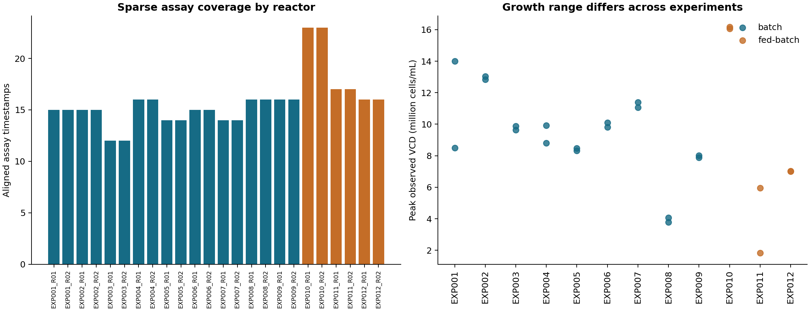
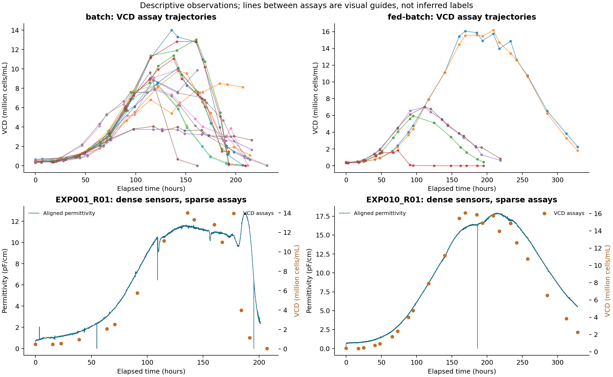
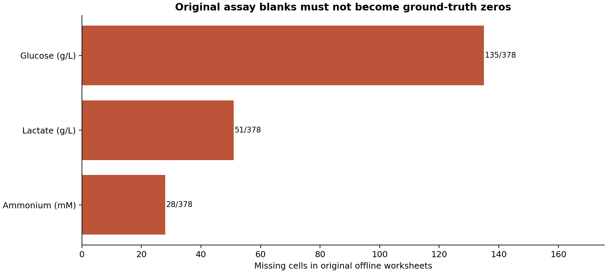

# BioSynvia dataset EDA report

November 5, 2026. Descriptive analysis of the real publisher archive. No model fitted.

Follow-up: [the focused quality review](../quality-review/report.md) distinguishes
the aligned EXP011_R02 cutoff from longer original sensor streams and identifies
six recorded VCD zeros pending scientific interpretation. Nonmissing numeric
coverage below does not imply approved training labels. See also
[loading methodology and distinct values](../unique-values/methodology.md).

## Executive findings

- The verified archive contains 12 experiments and 24 reactor runs: 9 batch and
  3 fed-batch experiments, each with two reactors. The scientific grouping unit
  is the experiment; the two reactors must remain together during evaluation.
- There are 274,781 aligned sensor timestamps
  and 378 aligned assay timestamps.
  Sensor rows are not independent biological experiments or additional assay labels.
- VCD has 378 nonmissing original measurements across all 24 reactors and 12
  experiments. It is a well-covered candidate, pending quality and feature review.
- The aligned CSVs appear complete, but 214
  blank original assay cells appear as zeros. Treating these as measured zeros
  would change the scientific data. Preserve the original missingness mask.
- Sensor sampling is nominally one minute but includes long gaps and early
  endings. 14 assay timestamps occur after their
  reactor's final aligned sensor timestamp. A causal join needs freshness limits.

## 1. What the dataset contains

This is a laboratory CHO-K1 cell-culture dataset from Uhlendorff, Fulek, Eimler,
Pein-Hackelbusch and Frahm. CHO means Chinese hamster ovary. The research task is
to investigate whether frequently recorded reactor signals can estimate a
sparsely measured biological attribute. Batch and fed-batch are process-mode
labels supplied by the source; this EDA does not estimate a causal mode effect.

Source: https://zenodo.org/records/20829178
DOI: `10.5281/zenodo.20829178`.

The ZIP is 227,627,771 bytes. Its MD5 matches the published digest
`71b2a35b7df2ed11644ec9f177453772`. SHA-256:
`46a6b92b77883d56df3be015895d93c85b2b2547121af0b8bc0a92f3fbefd17b`.
Reuse status remains unverified; this work does not redistribute the raw archive.

| Layer | Observed contents |
| --- | --- |
| Original files | 12 Excel workbooks, 16 sheets each, 192 sheets in total |
| Aligned sensor files | 24 CSVs; 40 numeric variables plus elapsed time |
| Aligned assay files | 24 CSVs; 16 numeric fields plus elapsed time |
| Sensor variables | 38 other sensor/process fields plus cumulative NaOH and feed weights |
| Assay fields | 10 primary assay fields plus 6 SEM fields |

SEM columns accompany replicate measurement summaries; they are not six extra
independent targets. No measurement method or unit conversion is inferred solely
from these labels. The field dictionary preserves the complete original headers.
For `C (300kHz)` and similar fields, the parenthesis denotes frequency, not a
verified unit for the measured C value. Header extraction must not become unit approval.

Sensor families include dissolved CO2/O2, turbidity transmission/reflection,
conductivity/permittivity and frequency-dependent C channels, process settings,
liquid volume and cumulative additions. Assays cover viable/total cell density,
viability, cell diameter/compactness/aggregation, glucose, lactate, ammonium and
osmolality.

## 2. Coverage and growth behavior

Each reactor has 12–23 assay timestamps.
Final assay times range from 161.5 to
328.5 hours. Per-run median assay intervals range from
11.5 to 17.0
hours, with a maximum observed gap of 30.0 hours.

VCD spans 0–16,166,666.7 cells/mL. Zero VCD entries are present in the original
workbooks and are not automatically recoded as missing. Assay validity and limits
of detection still require review. Growth trajectories differ substantially among
experiments. These are descriptive differences, not estimates of process-mode
effects or model performance.

Lines joining assay points are visual guides only. They do not create interpolated
ground-truth labels. The two illustrative sensor/assay panels use separate axes;
their visual similarity is not a fitted calibration or proof of predictability.

## 3. Original assay missingness versus aligned zeros

5,834 original nonmissing
assay cells match the aligned CSV value at the same reactor, field and timestamp
within relative/absolute tolerance `1e-8`. Another 214 original blanks align to
zero: 135 glucose, 51 lactate and 28 ammonium cells. No other comparison status
was observed. All 378 original VCD means match aligned values at original assay times.

The aligned CSVs contain zero missing/nonfinite numeric cells, which alone is a
misleading quality signal. Missingness must be measured against the original sheets.
The cause of each blank is unknown; this EDA does not label blanks as depletion,
below detection limit, or equipment failure.

| Assay | Measured values | Missing values | Coverage (%) |
| --- | --- | --- | --- |
| Aggregation Mean (%) | 378 | 0 | 100.0 |
| Ammonium (mM) | 350 | 28 | 92.6 |
| Avg. compactness Mean | 378 | 0 | 100.0 |
| Avg. diameter Mean (µm) | 378 | 0 | 100.0 |
| Glucose (g/L) | 243 | 135 | 64.3 |
| Lactate (g/L) | 327 | 51 | 86.5 |
| Osmolality (mOsmol/kg) | 378 | 0 | 100.0 |
| TCD Mean (cells/mL) | 378 | 0 | 100.0 |
| VCD Mean (cells/mL) | 378 | 0 | 100.0 |
| Viability Mean (%) | 378 | 0 | 100.0 |

## 4. Timestamp quality and sensor availability

All 48 aligned tables have finite, nonnegative, increasing timestamps with no
duplicates. This does not establish that upstream alignment was causal.
Median adjacent sensor time intervals are one minute in every reactor; the largest
observed gap is 37.45 hours in EXP005_R02.

EXP011_R02 aligned sensor data end at 67.13 hours while its assay table continues
to 195 hours. Other early endings also occur. Across all reactors,
27 assay timestamps have a latest prior
aligned sensor row more than one hour old; the maximum age is
127.87 hours.

The following is a sensitivity count using *any aligned sensor row*, not a
recommended scientific cutoff and not a count of approved model features:

| Maximum prior-sensor age | Assay timestamps with a sensor this recent |
| --- | --- |
| 1 minute | 345 |
| 5 minutes | 348 |
| 30 minutes | 350 |
| 1 hour | 351 |

Use acquisition/availability timestamps and a reviewed maximum lag before fitting.
Do not carry the last sensor value indefinitely or use a future row to fill a gap.

## 5. Sensor quality signals to investigate

The C (300kHz) channel is entirely zero in EXP001_R02, EXP002_R02, EXP003_R02. The field summary
also shows three constant-zero runs for other C channels and Cole-fit outputs.
This suggests unavailable or inactive fitted channels in those runs, but the cause
is not established. Do not assume a numeric zero is a usable sensor observation.

Examples of ranges requiring source/instrument review include total aeration
down to -0.259 sL/h, agitation up to 3,000 rpm, and negative cumulative NaOH weights.
Negative reflection or corrected dielectric signals are not automatically invalid;
instrument meaning and preprocessing must be checked first.

Original sensor sheets include status fields absent from aligned CSVs. Header and
first-row inspection found a `Warning Active` status in EXP001_R01 permittivity.
This EDA does not count every original sensor status, classify the warning, or
reconstruct upstream interpolation. Full raw sensor/status auditing remains open.
Long identical-value spans are recorded in `field_dictionary.csv`; these may be
setpoints, resampling effects or faults and are not automatically removed.

## 6. Target and implementation decision

VCD is the strongest initial candidate on coverage grounds: 378 original means,
24 reactors, 12 experiment groups, with an explicit cells/mL header. This is a
provisional recommendation, not scientific approval or evidence of predictive
accuracy. TCD, viability, diameter, compactness, aggregation and osmolality also
have complete original coverage. Glucose, lactate and ammonium require their raw
missingness masks and have fewer observed targets.

Before modeling:

1. Preserve original assay values and missingness; never train against filled zeros.
2. Restore sensor status provenance and review upstream time alignment.
3. Define sensor-only feature eligibility, freshness limits and abstention behavior.
4. Review VCD meaning, assay quality and target decision; preserve real zeros.
5. Freeze whole-experiment partitions before model tuning. Only three fed-batch
   experiment groups are available; subgroup estimates will be uncertain.

No train/test split or performance comparison was produced by this EDA. All data
were inspected descriptively; document this exploratory access when freezing a
later evaluation protocol. Model results must not be used to revise the final holdout.

## 7. Scope, method and reproducibility

Analyzed all cells of all 48 aligned CSVs, original workbook sheet headers and
dimensions, and all original offline assay cells. Original inline status/value
streams were not exhaustively scanned. The archive and its members remain unchanged.
Numeric conversion flags aligned blank/unparseable/nonfinite values separately;
statistics use finite values. Original assay matching uses reactor, field and
elapsed time with `1e-8` hour matching tolerance. No imputation, smoothing,
normalization, unit conversion, fitted models, correlation screening, hypothesis
tests or synthetic labels were used. Charts scale VCD by one million for display.

Reproduce with `scripts/eda.py`; follow `scripts/README.md` for environment setup
and commands. Use a new output directory on rerun to preserve prior results.
Environment versions and source fingerprints are in `summary.json` and
`source_manifest.json`.

Supporting tables: `dataset_inventory.csv`, `workbook_sheet_inventory.csv`,
`table_profiles.csv`, `field_dictionary.csv`, `field_summary.csv`,
`raw_assay_coverage.csv`, `target_coverage.csv`, `assay_comparison_summary.csv`,
`raw_aligned_assay_comparison.csv`, `assay_sensor_availability.csv`, and
`vcd_by_run.csv`.

## Appendix: per-reactor sampling summary

`last_hour_assay` and `last_hour_sensor` are final timestamps, not proof of a
complete acquisition period. `max_interval_hours` is the largest adjacent sensor gap.

| run | mode | rows_assay | last_hour_assay | rows_sensor | last_hour_sensor | max_interval_hours |
| --- | --- | --- | --- | --- | --- | --- |
| EXP001_R01 | batch | 15 | 207.0 | 11908 | 201.25 | 0.033 |
| EXP001_R02 | batch | 15 | 207.0 | 11839 | 201.233 | 0.05 |
| EXP002_R01 | batch | 15 | 209.5 | 12402 | 209.633 | 0.067 |
| EXP002_R02 | batch | 15 | 209.5 | 12339 | 209.6 | 0.067 |
| EXP003_R01 | batch | 12 | 161.5 | 8475 | 162.05 | 14.65 |
| EXP003_R02 | batch | 12 | 161.5 | 8298 | 162.033 | 14.6 |
| EXP004_R01 | batch | 16 | 212.0 | 12566 | 212.1 | 0.05 |
| EXP004_R02 | batch | 16 | 212.0 | 12481 | 212.083 | 0.033 |
| EXP005_R01 | batch | 14 | 190.5 | 10172 | 190.817 | 19.75 |
| EXP005_R02 | batch | 14 | 190.5 | 7653 | 190.817 | 37.45 |
| EXP006_R01 | batch | 15 | 214.0 | 10761 | 214.117 | 15.45 |
| EXP006_R02 | batch | 15 | 214.0 | 10893 | 214.1 | 15.467 |
| EXP007_R01 | batch | 14 | 193.0 | 11274 | 193.15 | 0.067 |
| EXP007_R02 | batch | 14 | 193.0 | 11281 | 193.133 | 0.05 |
| EXP008_R01 | batch | 16 | 216.0 | 12658 | 216.017 | 0.05 |
| EXP008_R02 | batch | 16 | 216.0 | 12763 | 215.983 | 0.05 |
| EXP009_R01 | batch | 16 | 231.0 | 13473 | 231.167 | 0.383 |
| EXP009_R02 | batch | 16 | 231.0 | 13500 | 231.233 | 0.4 |
| EXP010_R01 | fed-batch | 23 | 328.5 | 17896 | 328.517 | 0.083 |
| EXP010_R02 | fed-batch | 23 | 328.5 | 19099 | 328.517 | 0.067 |
| EXP011_R01 | fed-batch | 17 | 195.0 | 9331 | 180.383 | 0.1 |
| EXP011_R02 | fed-batch | 17 | 195.0 | 3983 | 67.133 | 0.05 |
| EXP012_R01 | fed-batch | 16 | 219.0 | 7305 | 219.183 | 23.617 |
| EXP012_R02 | fed-batch | 16 | 219.0 | 12431 | 219.117 | 8.517 |
