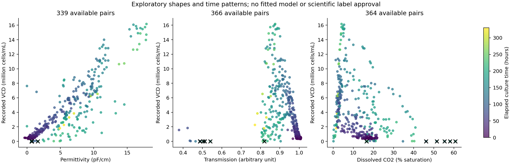

# Saved preparation and relationship inspection

November 5, 2026. Current completed output: `data/processed/v3`.

## What is now saved

The publisher archive is unchanged. A separate verified copy is stored as
`data/backups/Dataset_46a6b92b77883d56.zip`. Its SHA-256 matches the original.
Preparation reads the backup and transforms deep working DataFrame copies.

| Saved table | Rows | Purpose |
| --- | --- | --- |
| combined_inline | 274,781 | Combined aligned sensor observations with source/run metadata |
| aligned_offline | 378 | Combined aligned assays, retained for source comparison |
| original_offline | 378 | Original assay values and true missingness, with source provenance |
| feature_lineage | 15,120 | Forty raw-derived candidate fields at each of 378 assay times |
| processed_candidates | 378 | All original assay times, input/target labels and quality/review flags |
| inspection_subset | 333 | Provisional complete-case eight-feature/nonzero-target inspection subset |

Each table is available as a CSV and in the indexed `biosynvia.sqlite` database.
Queries can filter the saved data without reopening Excel. The database does not
store every raw sensor row; the complete archive remains backed up, and snapshots
retain source worksheet, row, timestamp, status and file digest.

## How rows and columns were handled

Aligned combined data have 46 sensor-table columns and 22 assay-table columns,
including five appended metadata columns. Eight domain-motivated sensor inputs
form the initial inspection subset. All forty raw-derived candidate inputs remain
available in the broader processed table and lineage. Mode is encoded explicitly
as 0=batch/1=fed-batch but remains context rather than a default model input.
Identifiers remain keys/group metadata, never arbitrary numeric predictors.

Datatype/null/unique audit, source descriptive statistics and DataFrame size
estimates are saved alongside the tables. No newly unparseable/nonfinite numeric
values were found by the conversion audit. Recorded original nulls remain null.
The pipeline performed no target interpolation, fitted imputation or scaling.

The 214 originally blank assay cells remain missing. All six recorded VCD zeros
remain present with pending-review flags; none was silently converted to missing.
The provisional inspection subset omits these six review cases plus 39 rows with
incomplete core inputs under the current quality/freshness settings. The 378-row
parent table retains every row and its disposition. This subset is not a scientific
rejection of those records and is not approved for training.

The five-minute maximum sensor age is a configurable, unapproved inspection
assumption. Candidate extraction uses the latest prior acquisition-time record.
Source Status warnings/missing statuses, stale inputs and derived channels whose
past history is entirely zero are flagged and omitted from candidate feature
values. Original values remain in lineage. Availability-time semantics and units
still require review.

## Newly exposed source issue

Original EXP004 streams contain duplicate source timestamps in eight reactor/stream
combinations. These events are recorded in `source_issues.json`. Competing rows are
not silently deduplicated. If a snapshot lands on an ambiguous source timestamp,
its value is withheld and competing source values are retained as JSON evidence.
In this run, none of the selected assay cutoffs required an ambiguous latest row;
that does not clear the underlying source issue.

## Relationship checks performed

Saved Pearson feature-to-feature matrices, feature-to-target Pearson/Spearman
summaries with pair counts, within-run-centered Pearson and a nonzero-target
sensitivity comparison. These are pooled descriptive checks, not feature-selection
decisions, significance tests or causal findings. All source data have been
explored; final evaluation must disclose this and must not be tuned using holdout
model outcomes.

Each dot is an available sensor/assay pair under the provisional inspection policy.
Color represents elapsed culture time. Black crosses indicate recorded zero VCD
values pending assay-quality interpretation. These are pooled observations; shapes
may reflect experiments, time, process settings or sensor effects. The plots do not
demonstrate causal relationships or validated predictive performance.

For the current snapshot policy, permittivity has Pearson association about 0.88
with recorded VCD over 339 available pairs. Transmission has Pearson about -0.16
but Spearman about -0.44 over 366 pairs. This difference motivates inspecting
shape, growth phase and experiments; it does not prove a particular nonlinear
model or justify automatic deletion. Read `reports/relationship-analysis-guide.md`
for nonlinear/time-dependent alternatives and their limitations.

## Verification and readiness

All 26 software tests pass in the optional analysis environment. Tests cover
working-copy isolation, verified backups, original blanks versus recorded zeros,
future perturbations, past-only derived-channel quality, warning/stale values,
duplicate conflicts and the earlier source/audit checks.

SQLite integrity and table counts were independently checked. Source/backup and
producer-code hashes match the manifest; output hashes are retained. No accepted
candidate snapshot uses a future source timestamp or a stale value. No scientific
label is marked approved, and `model_fit_permitted` remains false.

The first run stopped on duplicate source timestamps and remains an explicitly
incomplete directory. A diagnostic v2 run preceded the final past-only quality
rule and is superseded by v3. Use v3 for inspection. Original files remain intact.

Next: approve assay-zero interpretation, sensor status/units and availability
policies, freeze experiment-group evaluation, then fit preprocessing/feature
selection within development folds and compare simple baselines with selected
nonlinear or temporal alternatives. Mutual information, nonlinear models, lag
search and model explanation methods have not been fitted in this increment.
